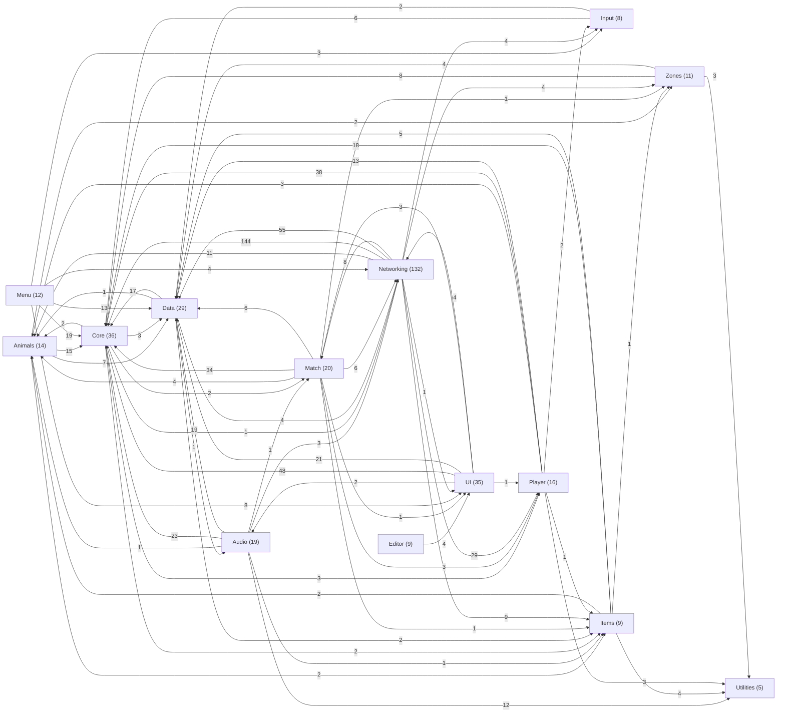

# Alien Farms — Arquitectura del código

Vault generado automáticamente por `Tools/generate_obsidian_docs.py` desde `Assets/Scripts`. **No edites** `Clases/` ni `Modulos/` a mano: se regeneran. Para notas propias crea archivos fuera de esas carpetas.

Tip: abre la **vista de grafo** (Ctrl+G) para ver las dependencias entre clases.

## Dependencias entre módulos

## Módulos

- [[Modulo Animals]] — 14 tipos
- [[Modulo Audio]] — 19 tipos
- [[Modulo Core]] — 36 tipos
- [[Modulo Data]] — 29 tipos
- [[Modulo Editor]] — 9 tipos
- [[Modulo Input]] — 8 tipos
- [[Modulo Items]] — 9 tipos
- [[Modulo Match]] — 20 tipos
- [[Modulo Menu]] — 12 tipos
- [[Modulo Networking]] — 132 tipos
- [[Modulo Player]] — 16 tipos
- [[Modulo UI]] — 35 tipos
- [[Modulo Utilities]] — 5 tipos
- [[Modulo Zones]] — 11 tipos

## Transversal
- [[Eventos GameEvents]] — quién publica y quién escucha cada evento global

## Jerarquías principales

```mermaid
classDiagram
  direction BT
  class Animal{
    <<abstract>>
  }
  class AnimalData{
    <<ScriptableObject>>
  }
  class AnimalSpawner{
    <<MonoBehaviour>>
  }
  class Bomb{
    <<MonoBehaviour>>
  }
  class BombSpawner{
    <<MonoBehaviour>>
  }
  class Chicken
  class ChickenData
  class CloudSavePlayerStatsStore
  class CountdownState
  class Cow
  class DirectConnection{
    <<MonoBehaviour>>
  }
  class IAnimalNetworkHook{
    <<interface>>
  }
  class IBombNetworkHook{
    <<interface>>
  }
  class IConnectionStrategy{
    <<interface>>
  }
  class IGrabbable{
    <<interface>>
  }
  class IMatchContext{
    <<interface>>
  }
  class IMatchExitHandler{
    <<interface>>
  }
  class IPendingStatsStore{
    <<interface>>
  }
  class IPlayerCommandSource{
    <<interface>>
  }
  class IPlayerRigLookup{
    <<interface>>
  }
  class IPlayerRoster{
    <<interface>>
  }
  class IPlayerStatsStore{
    <<interface>>
  }
  class IRandomSource{
    <<interface>>
  }
  class IScareable{
    <<interface>>
  }
  class ISimulationRoleTarget{
    <<interface>>
  }
  class IStunnable{
    <<interface>>
  }
  class IThrowable{
    <<interface>>
  }
  class IVolumeStore{
    <<interface>>
  }
  class IZoneResolver{
    <<interface>>
  }
  class LocalMatchExitHandler
  class LocalPlayerRigLookup{
    <<MonoBehaviour>>
  }
  class MatchManager{
    <<MonoBehaviour>>
  }
  class MatchState{
    <<abstract>>
  }
  class NetworkAnimal
  class NetworkBomb
  class NetworkCarriable{
    <<abstract>>
  }
  class NetworkCommandSource
  class NetworkPlayerRoster{
    <<MonoBehaviour>>
  }
  class NetworkSpawnRegistry{
    <<MonoBehaviour>>
  }
  class ObstacleField{
    <<MonoBehaviour>>
  }
  class OnlineMatchExitHandler
  class PlayerGrabber{
    <<MonoBehaviour>>
  }
  class PlayerInputHandler{
    <<MonoBehaviour>>
  }
  class PlayerJoinCoordinator{
    <<MonoBehaviour>>
  }
  class PlayerMovement{
    <<MonoBehaviour>>
  }
  class PlayerPrefsPendingStatsStore
  class PlayerPrefsVolumeStore
  class PlayerStunReceiver{
    <<MonoBehaviour>>
  }
  class PlayerZoneRegistry{
    <<MonoBehaviour>>
  }
  class PlayingState
  class RelaySessionConnection{
    <<MonoBehaviour>>
  }
  class ResultsState
  class Sheep
  class SimulatedFailureStatsStore
  class SystemRandomSource
  class WaitingForPlayersState
  Animal ..|> IScareable
  Animal ..|> ISimulationRoleTarget
  Animal ..|> IThrowable
  AnimalSpawner ..|> ISimulationRoleTarget
  Bomb ..|> ISimulationRoleTarget
  Bomb ..|> IThrowable
  BombSpawner ..|> ISimulationRoleTarget
  Chicken --|> Animal
  ChickenData --|> AnimalData
  CloudSavePlayerStatsStore ..|> IPlayerStatsStore
  CountdownState --|> MatchState
  Cow --|> Animal
  DirectConnection ..|> IConnectionStrategy
  IPlayerRoster ..|> IPlayerRigLookup
  IThrowable ..|> IGrabbable
  LocalMatchExitHandler ..|> IMatchExitHandler
  LocalPlayerRigLookup ..|> IPlayerRigLookup
  MatchManager ..|> IMatchContext
  NetworkAnimal --|> NetworkCarriable
  NetworkBomb --|> NetworkCarriable
  NetworkCommandSource ..|> IPlayerCommandSource
  NetworkPlayerRoster ..|> IPlayerRoster
  NetworkSpawnRegistry ..|> IAnimalNetworkHook
  NetworkSpawnRegistry ..|> IBombNetworkHook
  ObstacleField ..|> ISimulationRoleTarget
  OnlineMatchExitHandler ..|> IMatchExitHandler
  PlayerGrabber ..|> ISimulationRoleTarget
  PlayerInputHandler ..|> IPlayerCommandSource
  PlayerJoinCoordinator ..|> IPlayerRoster
  PlayerMovement ..|> ISimulationRoleTarget
  PlayerPrefsPendingStatsStore ..|> IPendingStatsStore
  PlayerPrefsVolumeStore ..|> IVolumeStore
  PlayerStunReceiver ..|> ISimulationRoleTarget
  PlayerStunReceiver ..|> IStunnable
  PlayerZoneRegistry ..|> IZoneResolver
  PlayingState --|> MatchState
  RelaySessionConnection ..|> IConnectionStrategy
  ResultsState --|> MatchState
  Sheep --|> Animal
  SimulatedFailureStatsStore ..|> IPlayerStatsStore
  SystemRandomSource ..|> IRandomSource
  WaitingForPlayersState --|> MatchState
```
