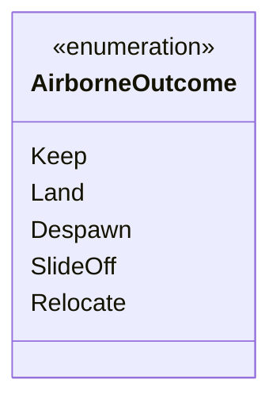

# AirborneOutcome

> What an airborne animal does this physics step (see `AnimalLanding.Evaluate`).

**Módulo:** [[Modulo Animals|Animals]] · **Namespace:** `AlienFarms.Animals` · **Archivo:** `Assets/Scripts/Animals/AirborneOutcome.cs`

## Diagrama

## Valores
`Keep`, `Land`, `Despawn`, `SlideOff`, `Relocate`

## Usado por
[[Animal]], [[AnimalLanding]]
