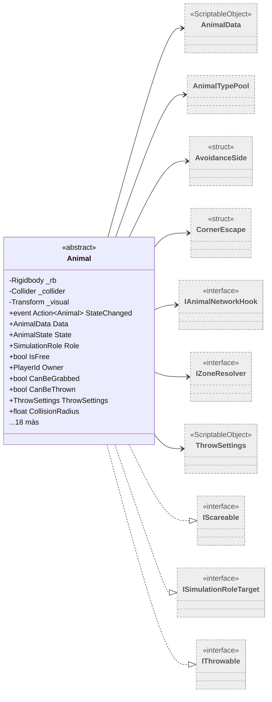

# Animal

> Pooled, Rigidbody-driven animal that wanders inside the Animal Zone, flees from nearby players and can be carried and thrown by a player. Derived types only change data and the flee direction. State flow: Wandering <-> Fleeing -> Carried -> (any release) Airborne -> (lands) Captured when it settles inside a player zone (counts for that zone's owner), otherwise Wandering. Captured -> Carried when either player grabs it. Only the private transition methods write the state; the transitions into and out of Captured are the single source of `GameEvents.OnAnimalCaptured` / `GameEvents.OnAnimalLeftZone`. As a `SimulationRole.Replica` it runs no AI, landing or grabbing and raises no GameEvents: its body is kinematic and its state comes from `ApplyReplicatedState`.

**Módulo:** [[Modulo Animals|Animals]] · **Namespace:** `AlienFarms.Animals` · **Archivo:** `Assets/Scripts/Animals/Animal.cs`

## Hereda / implementa
`MonoBehaviour`, [[IThrowable]], [[IScareable]], [[ISimulationRoleTarget]]

## Derivados / implementaciones
[[Chicken]], [[Cow]], [[Sheep]]

## Diagrama

## Usa
[[AirborneOutcome]], [[AnimalData]], [[AnimalLanding]], [[AnimalState]], [[AnimalSteering]], [[AnimalTypePool]], [[AvoidanceSide]], [[Bomb]], [[CornerEscape]], [[DropReason]], [[GameEvents]], [[IAnimalNetworkHook]], [[IScareable]], [[ISimulationRoleTarget]], [[IThrowable]], [[IZoneResolver]], [[LayerNames]], [[ObstacleAvoidance]], [[PlayerId]], [[SimulationRole]], [[ThrowSettings]]

## Usado por
[[AnimalData]], [[AnimalSfxPlayer]], [[AnimalSpawner]], [[AnimalTypePool]], [[Bomb]], [[BombSpawner]], [[Chicken]], [[Cow]], [[GameEvents]], [[IAnimalNetworkHook]], [[LayerNames]], [[MatchManager]], [[NetworkAnimal]], [[NetworkAnimalPoolHandler]], [[NetworkSpawnRegistry]], [[PlayerGrabber]], [[Sheep]], [[ThirdPersonCamera]], [[ThrowTrajectoryView]]

## Eventos que publica
[[Eventos GameEvents#OnAnimalCaptured|OnAnimalCaptured]], [[Eventos GameEvents#OnAnimalDropped|OnAnimalDropped]], [[Eventos GameEvents#OnAnimalGrabbed|OnAnimalGrabbed]], [[Eventos GameEvents#OnAnimalLeftZone|OnAnimalLeftZone]]
