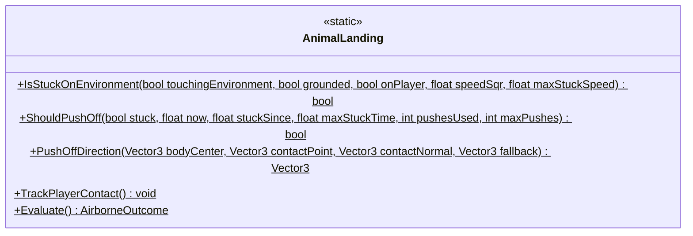

# AnimalLanding

> Pure rule that decides what an airborne animal does this physics step.

**Módulo:** [[Modulo Animals|Animals]] · **Namespace:** `AlienFarms.Animals` · **Archivo:** `Assets/Scripts/Animals/AnimalLanding.cs`

## Diagrama

## Usa
[[AirborneOutcome]]

## Usado por
[[Animal]]
