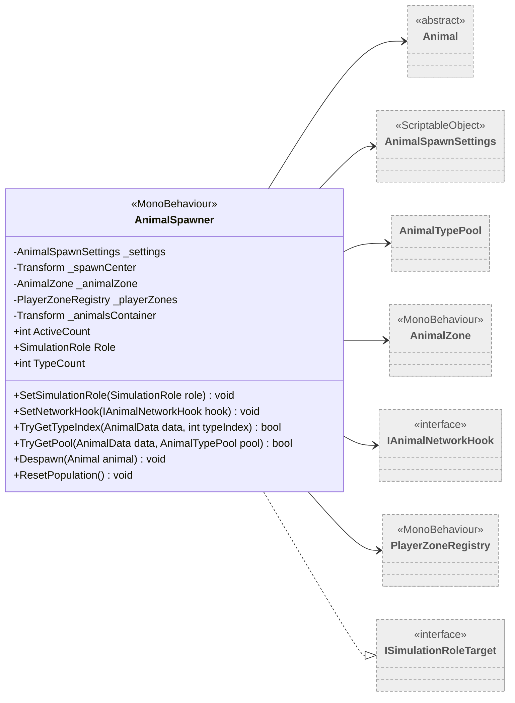

# AnimalSpawner

> Scene composition root for animals: owns one pool per type, spawns the initial population around a scene-placed center and refills it over time while the free population is below target. As a `SimulationRole.Replica` it only keeps the pools (for replicated animals) and never populates.

**Módulo:** [[Modulo Animals|Animals]] · **Namespace:** `AlienFarms.Animals` · **Archivo:** `Assets/Scripts/Animals/AnimalSpawner.cs`

## Hereda / implementa
`MonoBehaviour`, [[ISimulationRoleTarget]]

## Diagrama

## Usa
[[Animal]], [[AnimalData]], [[AnimalSpawnEntry]], [[AnimalSpawnSettings]], [[AnimalState]], [[AnimalSteering]], [[AnimalTypePool]], [[AnimalZone]], [[Bomb]], [[IAnimalNetworkHook]], [[ISimulationRoleTarget]], [[IZoneResolver]], [[LayerNames]], [[PlayerZoneRegistry]], [[SimulationRole]]

## Usado por
[[MatchManager]], [[NetworkAnimalPoolHandler]], [[NetworkSpawnRegistry]], [[OnlineMatchBootstrap]]
