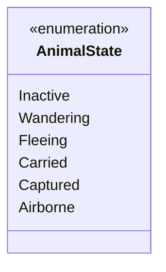

# AnimalState

> High-level behaviour state of an `Animal`.

**Módulo:** [[Modulo Animals|Animals]] · **Namespace:** `AlienFarms.Animals` · **Archivo:** `Assets/Scripts/Animals/AnimalState.cs`

## Diagrama

## Valores
`Inactive`, `Wandering`, `Fleeing`, `Carried`, `Captured`, `Airborne`

## Usado por
[[Animal]], [[AnimalNetState]], [[AnimalSpawner]], [[CaptureRules]], [[MatchScore]], [[NetworkAnimal]]
