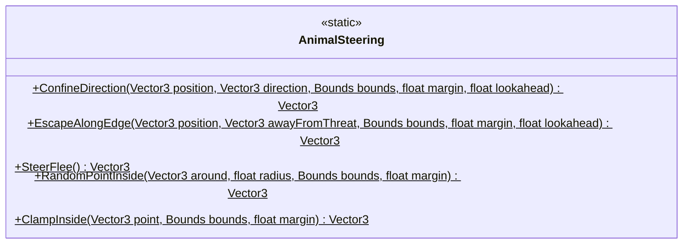

# AnimalSteering

> Pure planar (X/Z) steering helpers that keep animals inside a `Bounds` shrunk by a margin (the "inner rectangle"). Stateless, allocation-free and testable in EditMode.

**Módulo:** [[Modulo Animals|Animals]] · **Namespace:** `AlienFarms.Animals` · **Archivo:** `Assets/Scripts/Animals/AnimalSteering.cs`

## Diagrama

## Usa
[[CornerEscape]]

## Usado por
[[Animal]], [[AnimalSpawner]]
