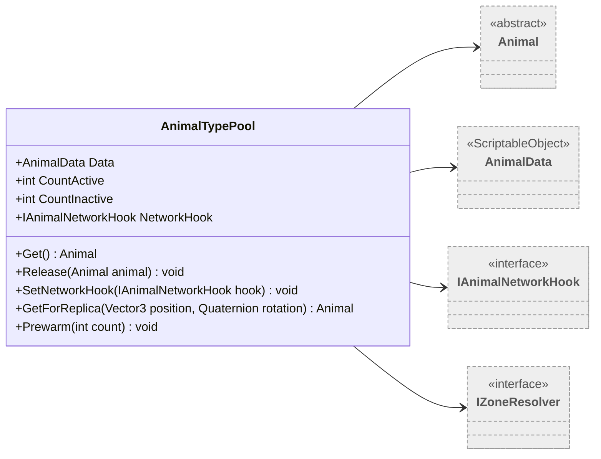

# AnimalTypePool

> Object pool for a single `AnimalData` type. Instances are created inactive under a container; activation is done by `Animal.Spawn` after positioning.

**Módulo:** [[Modulo Animals|Animals]] · **Namespace:** `AlienFarms.Animals` · **Archivo:** `Assets/Scripts/Animals/AnimalTypePool.cs`

## Diagrama

## Usa
[[Animal]], [[AnimalData]], [[IAnimalNetworkHook]], [[IZoneResolver]], [[SimulationRole]]

## Usado por
[[Animal]], [[AnimalSpawner]]
