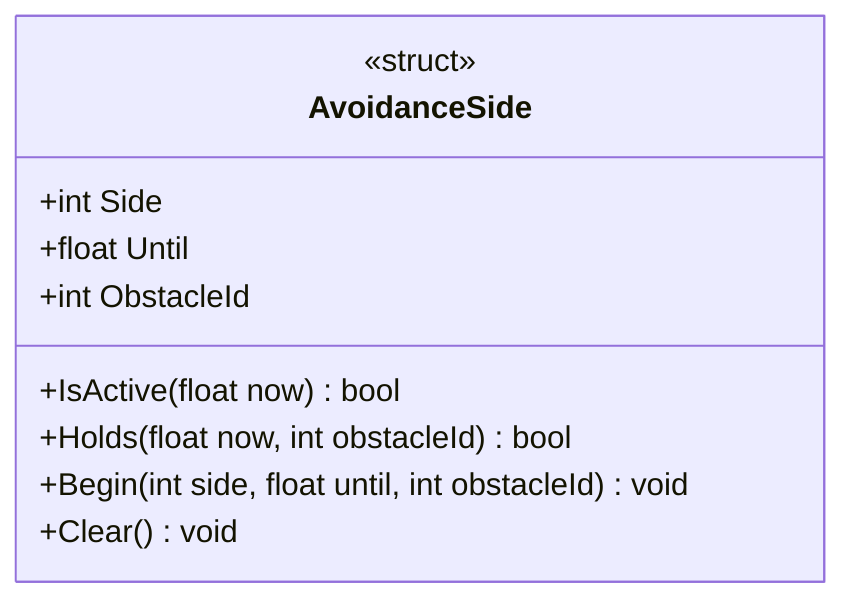

# AvoidanceSide

> Hysteresis state for `ObstacleAvoidance.Avoid`: once an animal picks a side to go around an obstacle, it keeps that side for that same obstacle until `Until`. The side survives expiry (it is reused when no hint is available) until `Clear`. Plain value type, passed by ref; the default value is "inactive, no side".

**Módulo:** [[Modulo Animals|Animals]] · **Namespace:** `AlienFarms.Animals` · **Archivo:** `Assets/Scripts/Animals/AvoidanceSide.cs`

## Diagrama

## Usado por
[[Animal]], [[ObstacleAvoidance]]
