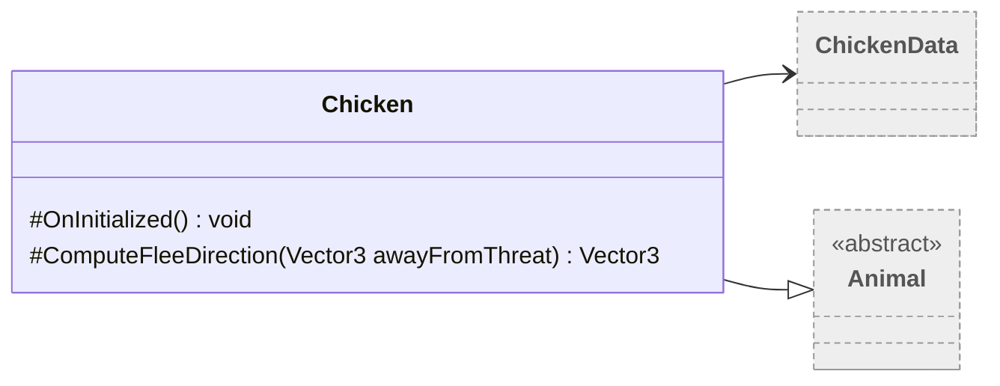

# Chicken

> Fast, light animal that zigzags while fleeing.

**Módulo:** [[Modulo Animals|Animals]] · **Namespace:** `AlienFarms.Animals` · **Archivo:** `Assets/Scripts/Animals/Chicken.cs`

## Hereda / implementa
[[Animal]]

## Diagrama

## Usa
[[Animal]], [[ChickenData]]
