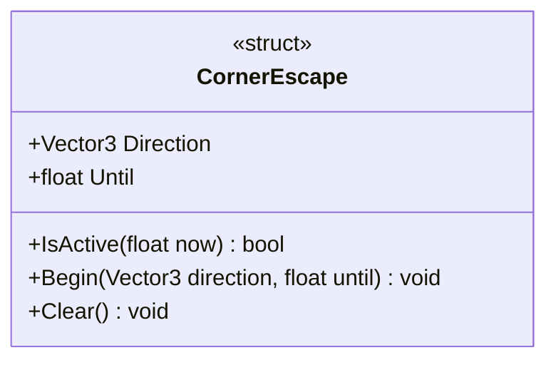

# CornerEscape

> Hysteresis state for `AnimalSteering.SteerFlee`: once a cornered animal picks an edge to run along, it keeps that axis direction at least until `Until` and, while still cornered, until the axis gets blocked. Plain value type, passed by ref; the default value is "inactive".

**Módulo:** [[Modulo Animals|Animals]] · **Namespace:** `AlienFarms.Animals` · **Archivo:** `Assets/Scripts/Animals/CornerEscape.cs`

## Diagrama

## Usado por
[[Animal]], [[AnimalSteering]]
