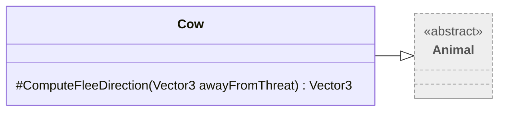

# Cow

> Heaviest animal: slow to react and to flee (straight line), worth the most points. Its carry and throw penalties live in its `AlienFarms.Data.AnimalData`.

**Módulo:** [[Modulo Animals|Animals]] · **Namespace:** `AlienFarms.Animals` · **Archivo:** `Assets/Scripts/Animals/Cow.cs`

## Hereda / implementa
[[Animal]]

## Diagrama

## Usa
[[Animal]]
