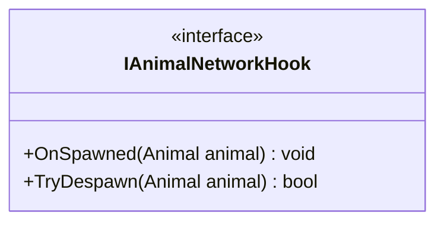

# IAnimalNetworkHook

> Lets a network layer follow the authority's animal lifecycle. Without a hook, animals go straight back to their pool on despawn (local mode).

**Módulo:** [[Modulo Animals|Animals]] · **Namespace:** `AlienFarms.Animals` · **Archivo:** `Assets/Scripts/Animals/IAnimalNetworkHook.cs`

## Diagrama

## Usa
[[Animal]]

## Usado por
[[Animal]], [[AnimalSpawner]], [[AnimalTypePool]]
