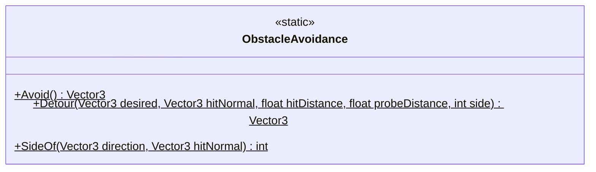

# ObstacleAvoidance

> Pure planar obstacle avoidance: given the desired direction and a probe hit in front of the animal, slides along the obstacle tangent and adds a small repulsion that grows as the hit gets closer. Stateless apart from the `AvoidanceSide` passed by ref; allocation-free and EditMode-testable.

**Módulo:** [[Modulo Animals|Animals]] · **Namespace:** `AlienFarms.Animals` · **Archivo:** `Assets/Scripts/Animals/ObstacleAvoidance.cs`

## Diagrama

## Usa
[[AvoidanceSide]]

## Usado por
[[Animal]]
