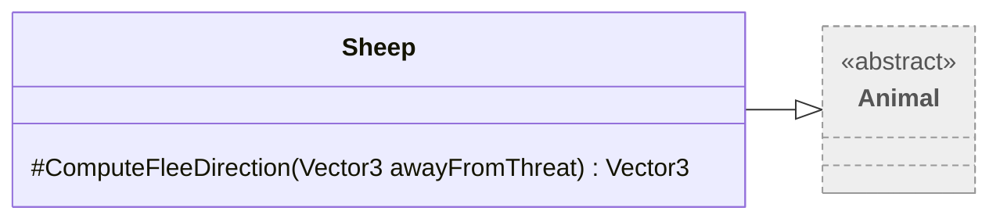

# Sheep

> Heavy, slow animal that flees in a straight line.

**Módulo:** [[Modulo Animals|Animals]] · **Namespace:** `AlienFarms.Animals` · **Archivo:** `Assets/Scripts/Animals/Sheep.cs`

## Hereda / implementa
[[Animal]]

## Diagrama

## Usa
[[Animal]]
