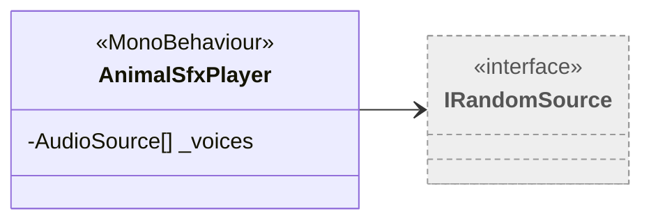

# AnimalSfxPlayer

> Plays animal voices: the grab voice when any player picks an animal up (stealing included, since the thief grabs it again after the tackle knocks it loose) and the alarm voice when it is thrown. Plain releases, steals and forced drops are silent. Uses a small pool of scene-owned 2D AudioSources (split-screen with a single AudioListener: positional audio would favour one player's view).

**Módulo:** [[Modulo Audio|Audio]] · **Namespace:** `AlienFarms.Audio` · **Archivo:** `Assets/Scripts/Audio/AnimalSfxPlayer.cs`

## Hereda / implementa
`MonoBehaviour`

## Diagrama

## Usa
[[Animal]], [[AnimalData]], [[AudioVariation]], [[DropReason]], [[GameEvents]], [[IRandomSource]], [[PlayerId]], [[SystemRandomSource]]

## Eventos que escucha
[[Eventos GameEvents#OnAnimalDropped|OnAnimalDropped]], [[Eventos GameEvents#OnAnimalGrabbed|OnAnimalGrabbed]]
