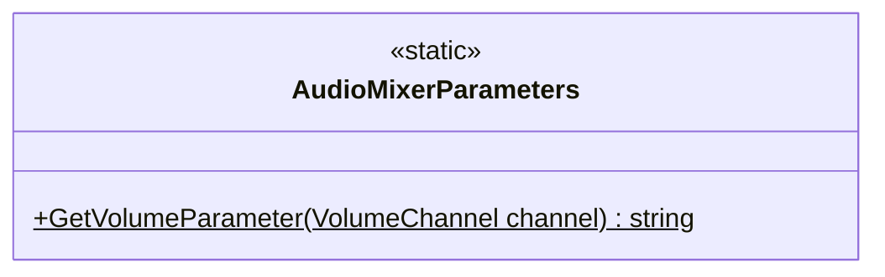

# AudioMixerParameters

> Names of the exposed AudioMixer parameters (volume of each group, in dB). The only place these strings live: they must match the exposed parameters of AlienFarmsMixer exactly.

**Módulo:** [[Modulo Audio|Audio]] · **Namespace:** `AlienFarms.Audio` · **Archivo:** `Assets/Scripts/Audio/AudioMixerParameters.cs`

## Diagrama

## Usa
[[VolumeChannel]]

## Usado por
[[AudioVolumeService]], [[VolumeState]]
