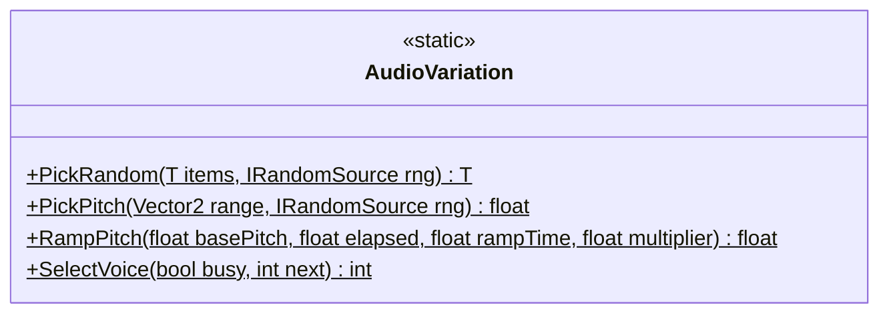

# AudioVariation

> Pure helpers that add variety to repeated sounds (random clip and pitch, voice selection).

**Módulo:** [[Modulo Audio|Audio]] · **Namespace:** `AlienFarms.Audio` · **Archivo:** `Assets/Scripts/Audio/AudioVariation.cs`

## Diagrama

## Usa
[[IRandomSource]], [[SoundCue]]

## Usado por
[[AnimalSfxPlayer]], [[BombSfxPlayer]]
