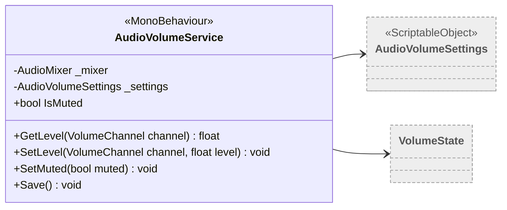

# AudioVolumeService

> Per-scene volume service: loads the saved levels (PlayerPrefs) and drives the exposed volume parameters of the AudioMixer. Not a singleton: each scene has one and options views reference it in the Inspector.

**Módulo:** [[Modulo Audio|Audio]] · **Namespace:** `AlienFarms.Audio` · **Archivo:** `Assets/Scripts/Audio/AudioVolumeService.cs`

## Hereda / implementa
`MonoBehaviour`

## Diagrama

## Usa
[[AudioMixerParameters]], [[AudioVolumeSettings]], [[PlayerPrefsVolumeStore]], [[VolumeChannel]], [[VolumeState]]

## Usado por
[[AudioOptionsView]]
