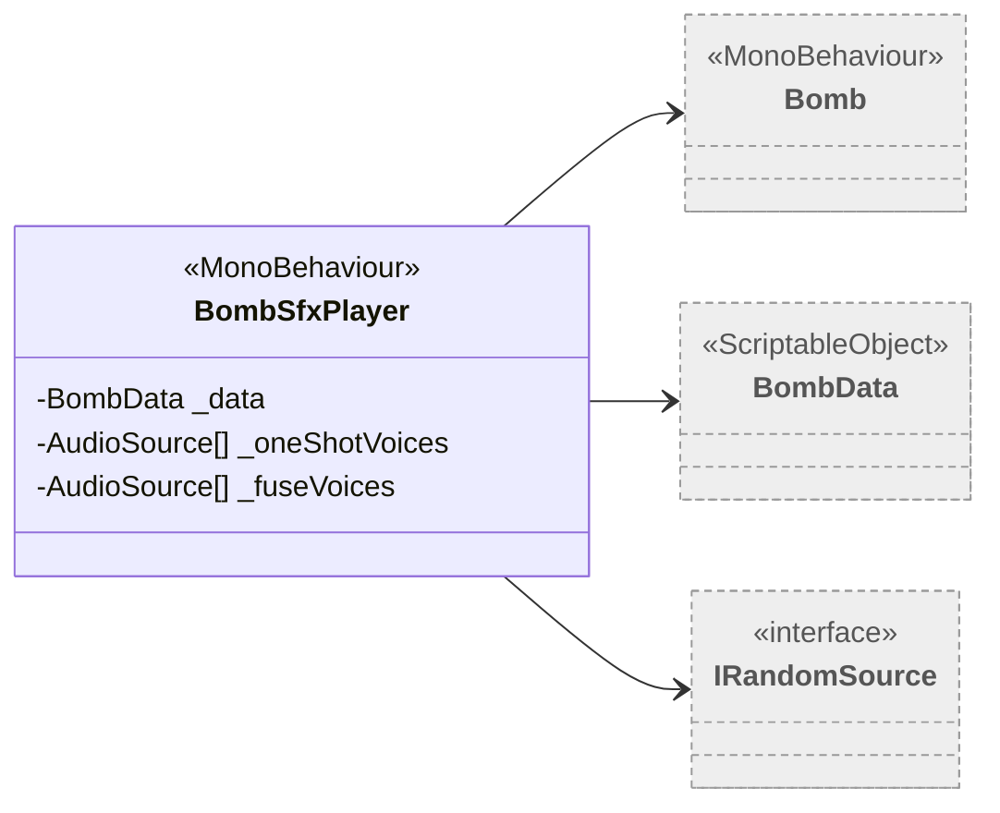

# BombSfxPlayer

> Plays the stun bomb sounds: spawn pop, grab, a looped fuse per armed bomb (its pitch rises while it flies and it is cut when that bomb detonates or leaves play), the explosion and one dizzy chime per stunned player. Scene-owned 2D AudioSources (split-screen with a single AudioListener: positional audio would favour one view). One-shots stay silent while the game is paused; the looped fuses obey AudioListener.pause.

**Módulo:** [[Modulo Audio|Audio]] · **Namespace:** `AlienFarms.Audio` · **Archivo:** `Assets/Scripts/Audio/BombSfxPlayer.cs`

## Hereda / implementa
`MonoBehaviour`

## Diagrama

## Usa
[[AudioVariation]], [[Bomb]], [[BombData]], [[GameEvents]], [[IRandomSource]], [[PlayerId]], [[SoundCue]], [[SystemRandomSource]]

## Eventos que escucha
[[Eventos GameEvents#OnBombArmed|OnBombArmed]], [[Eventos GameEvents#OnBombDespawned|OnBombDespawned]], [[Eventos GameEvents#OnBombDetonated|OnBombDetonated]], [[Eventos GameEvents#OnBombGrabbed|OnBombGrabbed]], [[Eventos GameEvents#OnBombSpawned|OnBombSpawned]], [[Eventos GameEvents#OnPlayerStunned|OnPlayerStunned]]
