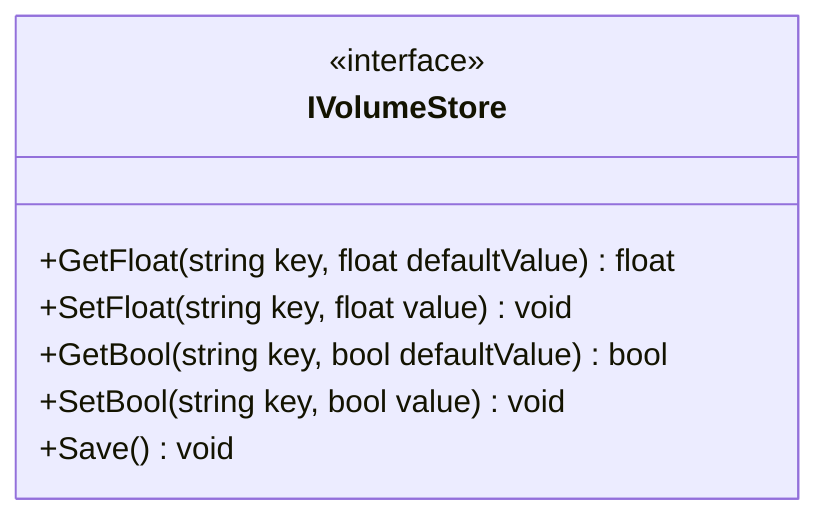

# IVolumeStore

> Key/value persistence for volume preferences (PlayerPrefs at runtime, a fake in tests).

**Módulo:** [[Modulo Audio|Audio]] · **Namespace:** `AlienFarms.Audio` · **Archivo:** `Assets/Scripts/Audio/IVolumeStore.cs`

## Derivados / implementaciones
[[PlayerPrefsVolumeStore]]

## Diagrama

## Usado por
[[PlayerPrefsVolumeStore]], [[VolumeState]]
