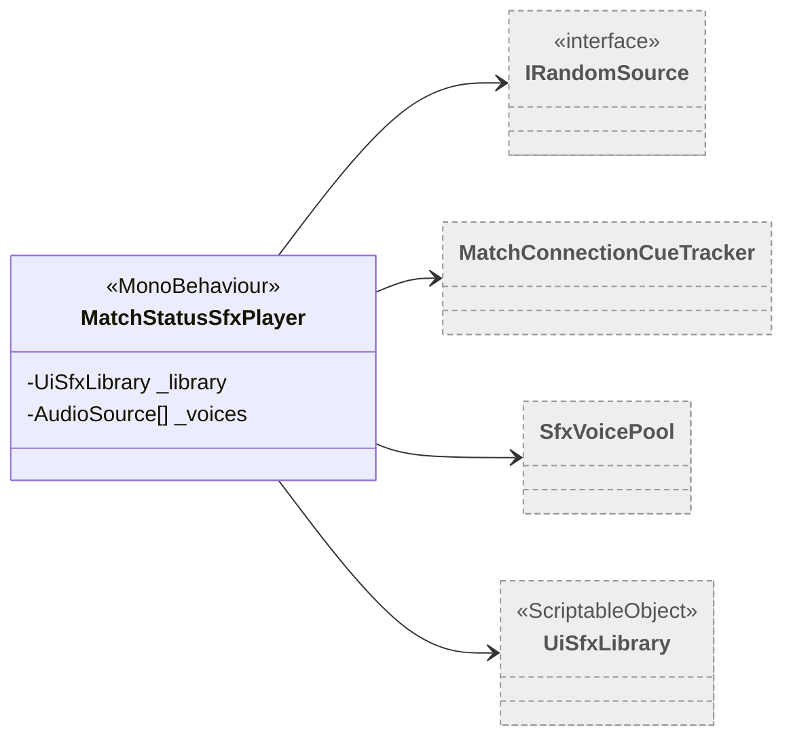

# MatchStatusSfxPlayer

**Módulo:** [[Modulo Audio|Audio]] · **Namespace:** `AlienFarms.Audio` · **Archivo:** `Assets/Scripts/Audio/MatchStatusSfxPlayer.cs`

## Hereda / implementa
`MonoBehaviour`

## Diagrama

## Usa
[[GameEvents]], [[IRandomSource]], [[MatchConnectionCueTracker]], [[MatchPhase]], [[PlayerConnectionStatus]], [[PlayerId]], [[SfxVoicePool]], [[SystemRandomSource]], [[UiSfxCue]], [[UiSfxLibrary]]

## Eventos que escucha
[[Eventos GameEvents#OnGamePaused|OnGamePaused]], [[Eventos GameEvents#OnMatchPhaseChanged|OnMatchPhaseChanged]], [[Eventos GameEvents#OnPauseMenuResumed|OnPauseMenuResumed]], [[Eventos GameEvents#OnPlayerConnectionChanged|OnPlayerConnectionChanged]]
