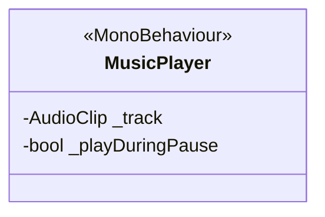

# MusicPlayer

> Loops a scene's music track on a 2D AudioSource (route its output to the Music mixer group). Optionally keeps playing while the game is paused (`AudioListener.pause`).

**Módulo:** [[Modulo Audio|Audio]] · **Namespace:** `AlienFarms.Audio` · **Archivo:** `Assets/Scripts/Audio/MusicPlayer.cs`

## Hereda / implementa
`MonoBehaviour`

## Diagrama

