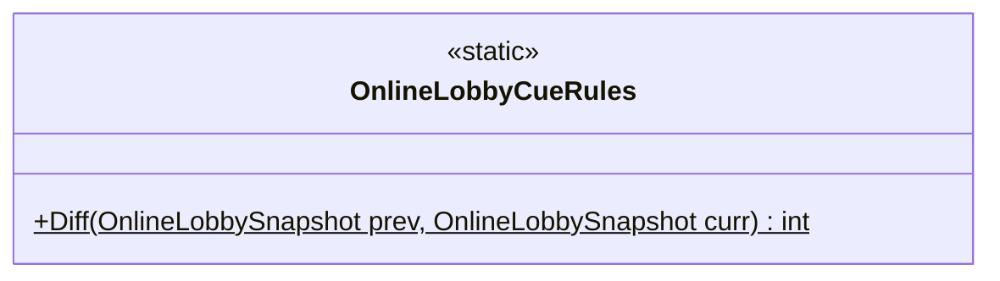

# OnlineLobbyCueRules

**Módulo:** [[Modulo Audio|Audio]] · **Namespace:** `AlienFarms.Audio` · **Archivo:** `Assets/Scripts/Audio/OnlineLobbyCueRules.cs`

## Diagrama

## Usa
[[OnlineLobbySeat]], [[OnlineLobbySnapshot]], [[PlayerId]], [[UiSfxCue]]

## Usado por
[[OnlineSessionSfxPlayer]]
