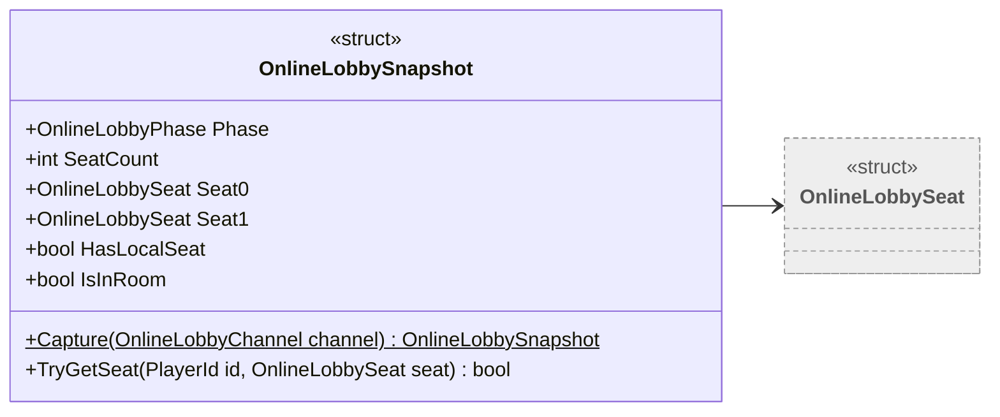

# OnlineLobbySnapshot

**Módulo:** [[Modulo Audio|Audio]] · **Namespace:** `AlienFarms.Audio` · **Archivo:** `Assets/Scripts/Audio/OnlineLobbySnapshot.cs`

## Diagrama

## Usa
[[OnlineLobbyChannel]], [[OnlineLobbyPhase]], [[OnlineLobbySeat]], [[Phase]], [[PlayerId]]

## Usado por
[[OnlineLobbyCueRules]], [[OnlineSessionSfxPlayer]]
