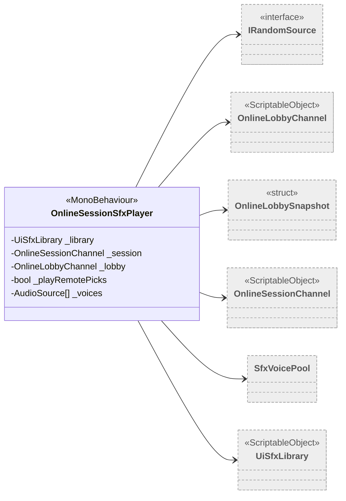

# OnlineSessionSfxPlayer

**Módulo:** [[Modulo Audio|Audio]] · **Namespace:** `AlienFarms.Audio` · **Archivo:** `Assets/Scripts/Audio/OnlineSessionSfxPlayer.cs`

## Hereda / implementa
`MonoBehaviour`

## Diagrama

## Usa
[[IRandomSource]], [[OnlineLobbyChannel]], [[OnlineLobbyCueRules]], [[OnlineLobbyPhase]], [[OnlineLobbySnapshot]], [[OnlineSessionChannel]], [[OnlineSessionCueRules]], [[OnlineSessionStatus]], [[Phase]], [[SfxVoicePool]], [[Status]], [[SystemRandomSource]], [[UiSfxCue]], [[UiSfxLibrary]]
