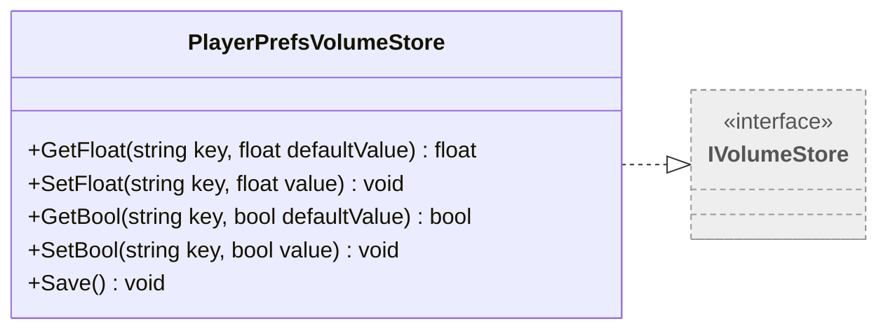

# PlayerPrefsVolumeStore

> `IVolumeStore` backed by `PlayerPrefs` (bools stored as 0/1 ints).

**Módulo:** [[Modulo Audio|Audio]] · **Namespace:** `AlienFarms.Audio` · **Archivo:** `Assets/Scripts/Audio/PlayerPrefsVolumeStore.cs`

## Hereda / implementa
[[IVolumeStore]]

## Diagrama

## Usa
[[IVolumeStore]]

## Usado por
[[AudioVolumeService]]
