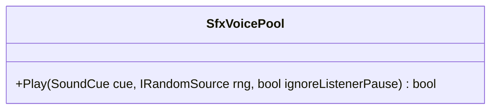

# SfxVoicePool

**Módulo:** [[Modulo Audio|Audio]] · **Namespace:** `AlienFarms.Audio` · **Archivo:** `Assets/Scripts/Audio/SfxVoicePool.cs`

## Diagrama

## Usa
[[AudioVariation]], [[IRandomSource]], [[SoundCue]]

## Usado por
[[CharacterSelectSfxPlayer]], [[MatchStatusSfxPlayer]], [[OnlineSessionSfxPlayer]]
