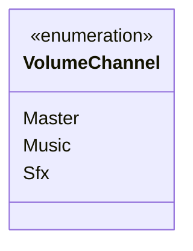

# VolumeChannel

> Volume channels exposed by the AlienFarmsMixer. Values index per-channel arrays.

**Módulo:** [[Modulo Audio|Audio]] · **Namespace:** `AlienFarms.Audio` · **Archivo:** `Assets/Scripts/Audio/VolumeChannel.cs`

## Diagrama

## Valores
`Master`, `Music`, `Sfx`

## Usado por
[[AudioMixerParameters]], [[AudioOptionsView]], [[AudioVolumeService]], [[AudioVolumeSettings]], [[VolumeState]]
