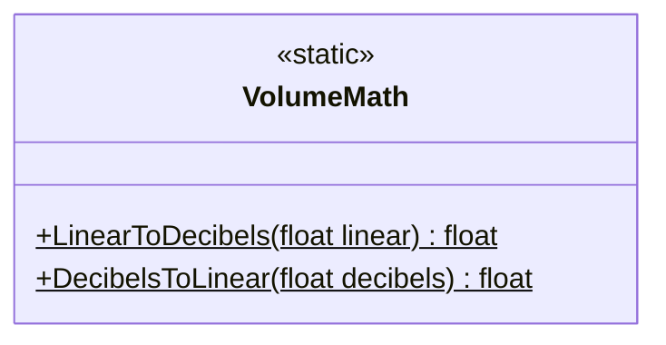

# VolumeMath

> Conversions between linear slider volume (0..1) and AudioMixer attenuation (dB).

**Módulo:** [[Modulo Audio|Audio]] · **Namespace:** `AlienFarms.Audio` · **Archivo:** `Assets/Scripts/Audio/VolumeMath.cs`

## Diagrama

## Usado por
[[VolumeState]]
