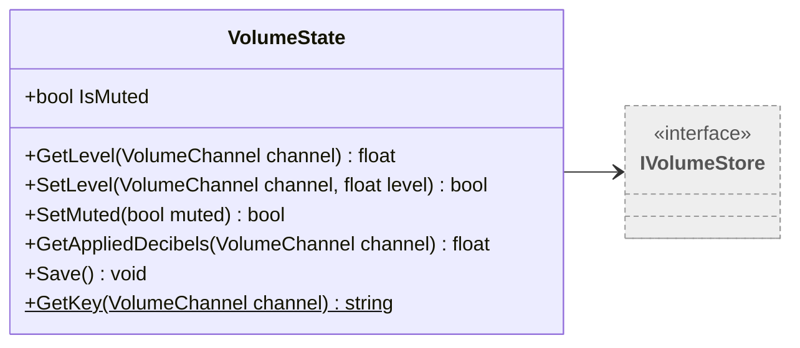

# VolumeState

> Plain C# volume model: linear level per `VolumeChannel` plus a master mute, loaded from and written through an `IVolumeStore`. Missing keys fall back to `AudioVolumeSettings` defaults.

**Módulo:** [[Modulo Audio|Audio]] · **Namespace:** `AlienFarms.Audio` · **Archivo:** `Assets/Scripts/Audio/VolumeState.cs`

## Diagrama

## Usa
[[AudioMixerParameters]], [[AudioVolumeSettings]], [[IVolumeStore]], [[VolumeChannel]], [[VolumeMath]]

## Usado por
[[AudioVolumeService]]
