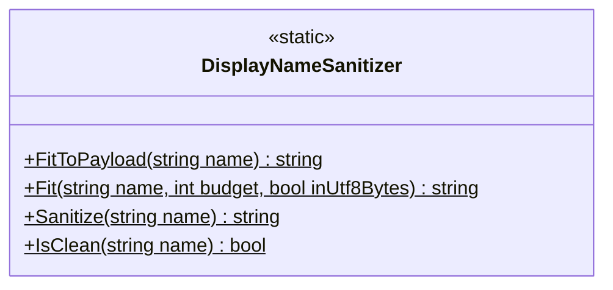

# DisplayNameSanitizer

> Cleans a player name that came from another machine (connection payload, session player property) before it is stored or shown: drops control and invisible format characters (zero-width, bidi overrides) and the rich text brackets '<' / '>' (TextMeshPro would parse tags), trims surrounding white space and caps it at `MaxLength` characters (never splitting a surrogate pair). A name that is empty afterwards stays empty (callers show their own placeholder). Every cut (`MaxLength` characters, `FitToPayload` bytes) keeps a trailing UGS discriminator ("Name#1234") and shortens the part before it. Pure.

**Módulo:** [[Modulo Core|Core]] · **Namespace:** `AlienFarms.Core` · **Archivo:** `Assets/Scripts/Core/DisplayNameSanitizer.cs`

## Diagrama

## Usado por
[[ConnectionPayload]], [[DisplayNameResolver]], [[NetworkLobbyState]], [[NetworkPlayer]], [[OnlineMenuController]], [[OnlinePanelView]], [[OnlineSessionChannel]], [[OnlineSessionService]], [[SessionExit]]
