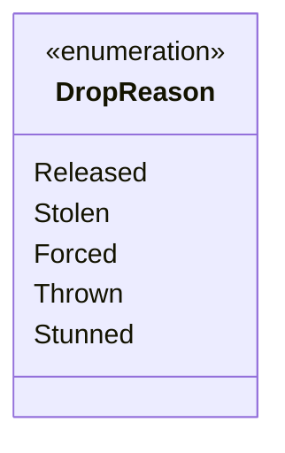

# DropReason

> Why a carried `IGrabbable` left its holder.

**Módulo:** [[Modulo Core|Core]] · **Namespace:** `AlienFarms.Core` · **Archivo:** `Assets/Scripts/Core/DropReason.cs`

## Diagrama

## Valores
`Released`, `Stolen`, `Forced`, `Thrown`, `Stunned`

## Usado por
[[Animal]], [[AnimalNetState]], [[AnimalSfxPlayer]], [[Bomb]], [[GameEvents]], [[IGrabbable]], [[Mode]], [[NetworkAnimal]], [[NetworkCarry]], [[NetworkPlayerRoster]], [[PlayerGrabber]], [[PlayerRig]], [[PlayerStunReceiver]], [[PlayerTackle]]
