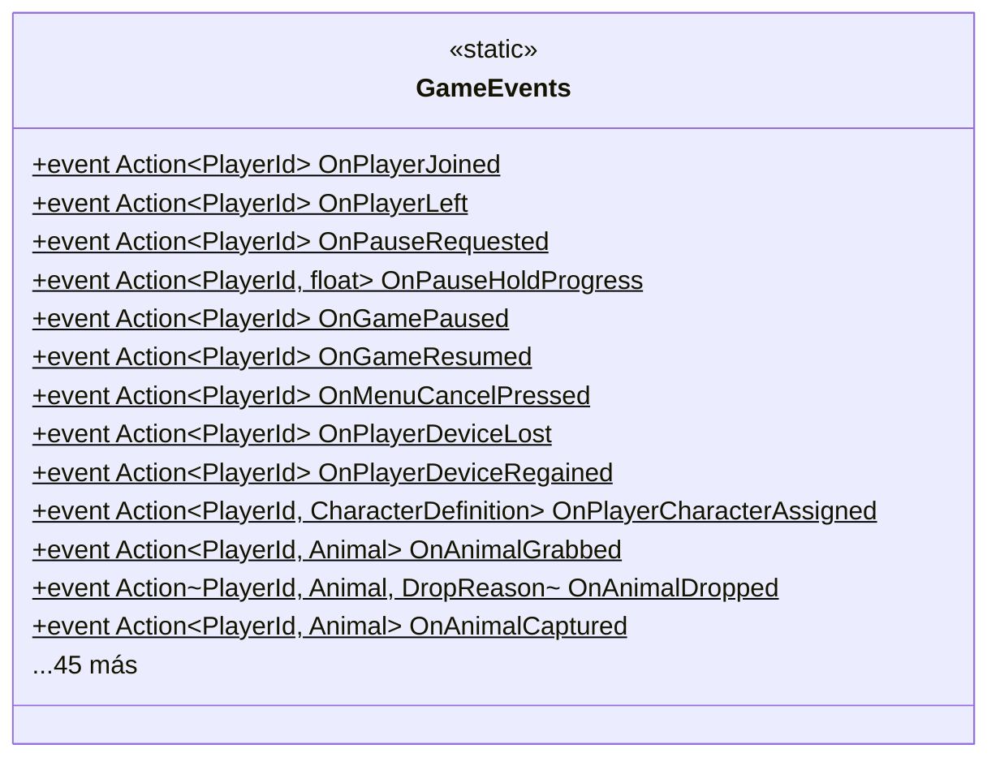

# GameEvents

> Global static events for decoupled communication between systems. Every per-player payload carries the `PlayerId` involved. Exception: match phase, countdown and match time are global to the round (shared by both players), so they carry no PlayerId; neither do bomb spawn/despawn, which belong to no player (the bomb lies in the shared Animal Zone or leaves play).

**Módulo:** [[Modulo Core|Core]] · **Namespace:** `AlienFarms.Core` · **Archivo:** `Assets/Scripts/Core/GameEvents.cs`

## Diagrama

## Usa
[[Animal]], [[Bomb]], [[CharacterDefinition]], [[DropReason]], [[MatchPhase]], [[MatchResult]], [[PlayerId]]

## Usado por
[[Animal]], [[AnimalSfxPlayer]], [[Bomb]], [[BombBlastVfxPlayer]], [[BombSfxPlayer]], [[BombSpawner]], [[CountdownState]], [[CountdownView]], [[JoinPromptView]], [[MatchManager]], [[MatchResultsView]], [[MatchStateMachine]], [[MatchTimerView]], [[PauseController]], [[PauseHoldIndicatorView]], [[PauseMenuView]], [[PlayerHudThemeView]], [[PlayerJoinCoordinator]], [[PlayerMenuInput]], [[PlayerMenuRouter]], [[PlayerPauseInput]], [[PlayerStunReceiver]], [[PlayingState]], [[ResultsMenuController]], [[ResultsState]], [[ScoreView]]
