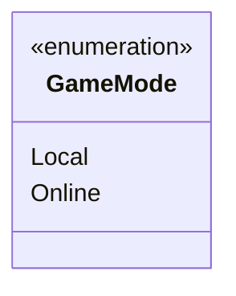

# GameMode

> How the gameplay scene is driven: local split-screen or online.

**Módulo:** [[Modulo Core|Core]] · **Namespace:** `AlienFarms.Core` · **Archivo:** `Assets/Scripts/Core/GameMode.cs`

## Diagrama

## Valores
`Local`, `Online`

## Usado por
[[DevConnectionPanel]], [[GameModeRouter]], [[JoinPromptView]], [[MatchSession]], [[OnlineModeRules]], [[OnlineSessionService]], [[SaveStatusBadgeView]], [[SessionExit]], [[Status]]
