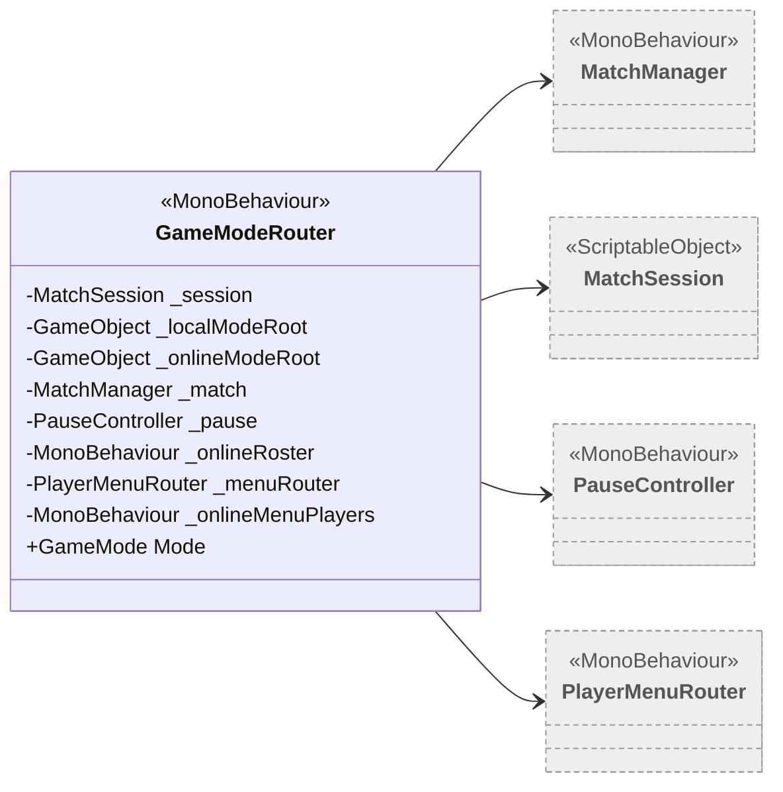

# GameModeRouter

> Composition root of the gameplay scene: reads `MatchSession.Mode` and activates the local or the online mode root, binds the match to that mode's `IPlayerRoster` and configures the pause. Both mode roots must be saved inactive: activating one here runs its children's Awake synchronously, before any other Awake of the scene, so role setters (spawners, obstacle field) apply before their Awake/Start. The online roster lives in the networking assembly; it is wired as a MonoBehaviour implementing IPlayerRoster, so this assembly never references networking types.

**Módulo:** [[Modulo Core|Core]] · **Namespace:** `AlienFarms.Core` · **Archivo:** `Assets/Scripts/Core/GameModeRouter.cs`

## Hereda / implementa
`MonoBehaviour`

## Diagrama

## Usa
[[GameMode]], [[IPlayerRigLookup]], [[IPlayerRoster]], [[MatchManager]], [[MatchSession]], [[Mode]], [[PauseController]], [[PlayerMenuRouter]]
