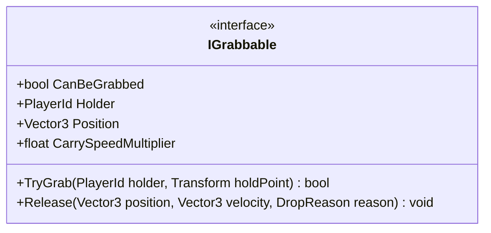

# IGrabbable

> Something a player can pick up, carry at a hold point and drop.

**Módulo:** [[Modulo Core|Core]] · **Namespace:** `AlienFarms.Core` · **Archivo:** `Assets/Scripts/Core/IGrabbable.cs`

## Derivados / implementaciones
[[IThrowable]]

## Diagrama

## Usa
[[DropReason]], [[PlayerId]]

## Usado por
[[IThrowable]], [[PlayerAim]], [[PlayerGrabber]]
