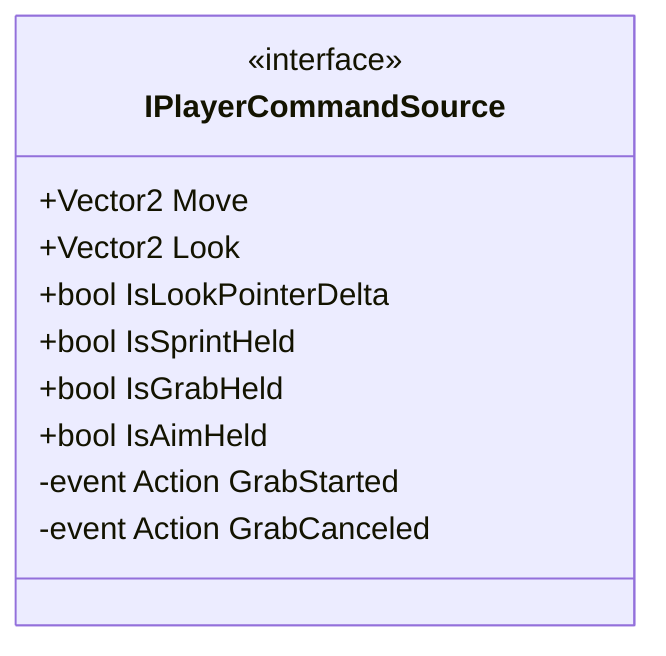

# IPlayerCommandSource

> Everything the player's gameplay components read from input. Implemented locally by the PlayerInputHandler and, online, by a network-fed source. Values are sampled every frame; events fire on button edges.

**Módulo:** [[Modulo Core|Core]] · **Namespace:** `AlienFarms.Core` · **Archivo:** `Assets/Scripts/Core/IPlayerCommandSource.cs`

## Derivados / implementaciones
[[NetworkCommandSource]], [[PlayerInputHandler]]

## Diagrama

## Usado por
[[NetworkCommandSource]], [[PlayerAim]], [[PlayerGrabber]], [[PlayerInputHandler]], [[PlayerMovement]], [[ThirdPersonCamera]]
