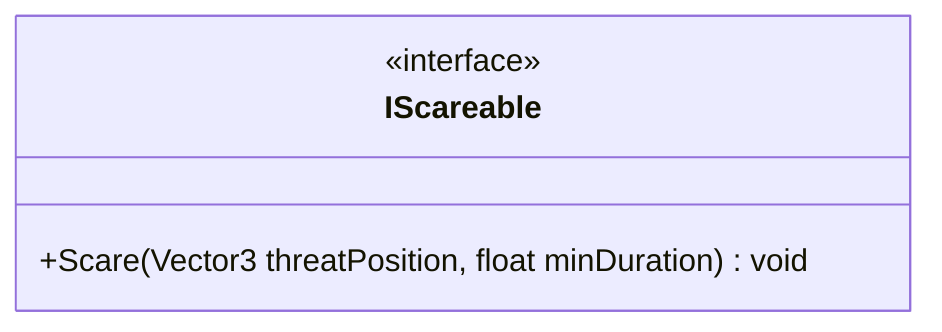

# IScareable

> Something that runs away from a sudden threat (e.g. a blast). Only free, grounded animals react.

**Módulo:** [[Modulo Core|Core]] · **Namespace:** `AlienFarms.Core` · **Archivo:** `Assets/Scripts/Core/IScareable.cs`

## Derivados / implementaciones
[[Animal]]

## Diagrama

## Usado por
[[Animal]], [[Bomb]]
