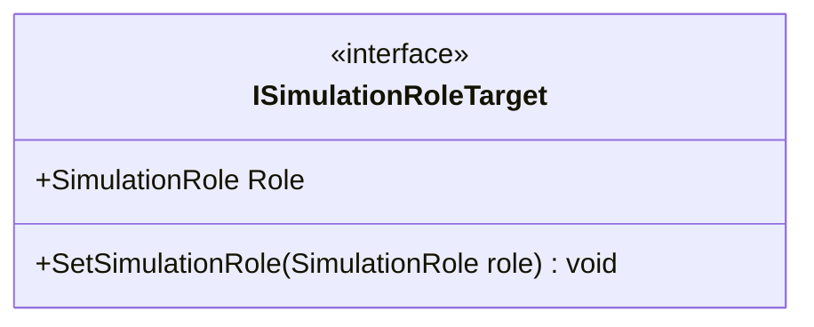

# ISimulationRoleTarget

> A component whose simulation can be switched between Authority (default) and Replica.

**Módulo:** [[Modulo Core|Core]] · **Namespace:** `AlienFarms.Core` · **Archivo:** `Assets/Scripts/Core/ISimulationRoleTarget.cs`

## Derivados / implementaciones
[[Animal]], [[AnimalSpawner]], [[Bomb]], [[BombSpawner]], [[ObstacleField]], [[PlayerGrabber]], [[PlayerMovement]], [[PlayerStunReceiver]]

## Diagrama

## Usa
[[SimulationRole]]

## Usado por
[[Animal]], [[AnimalSpawner]], [[Bomb]], [[BombSpawner]], [[ObstacleField]], [[PlayerGrabber]], [[PlayerMovement]], [[PlayerStunReceiver]]
