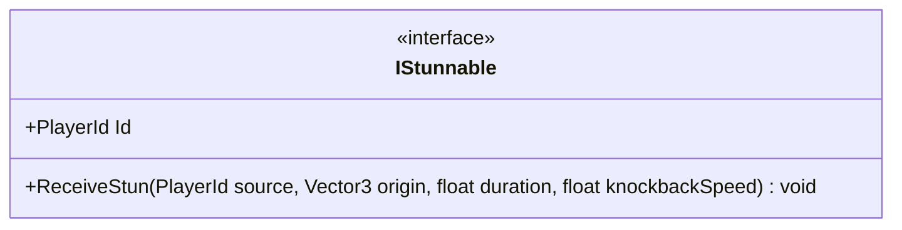

# IStunnable

> Something a blast can stun (a player): drops what it carries, gets knocked back and loses control.

**Módulo:** [[Modulo Core|Core]] · **Namespace:** `AlienFarms.Core` · **Archivo:** `Assets/Scripts/Core/IStunnable.cs`

## Derivados / implementaciones
[[PlayerStunReceiver]]

## Diagrama

## Usa
[[PlayerId]]

## Usado por
[[Bomb]], [[PlayerStunReceiver]]
