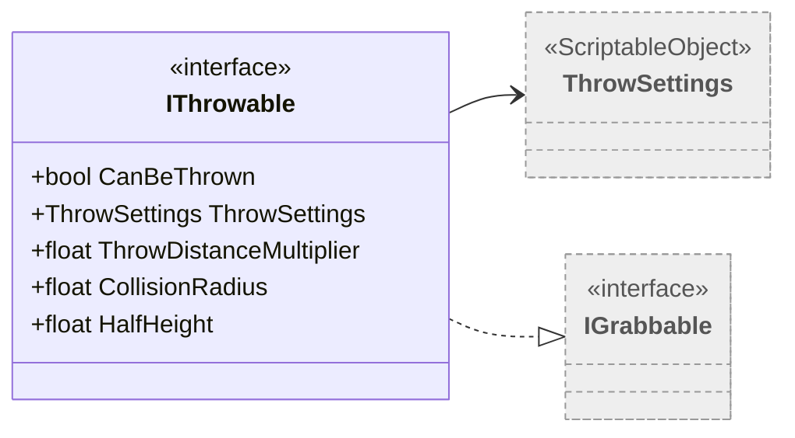

# IThrowable

> A grabbable that can be launched on a ballistic arc while carried. The launch itself goes through `IGrabbable.Release` with `DropReason.Thrown`.

**Módulo:** [[Modulo Core|Core]] · **Namespace:** `AlienFarms.Core` · **Archivo:** `Assets/Scripts/Core/IThrowable.cs`

## Hereda / implementa
[[IGrabbable]]

## Derivados / implementaciones
[[Animal]], [[Bomb]]

## Diagrama

## Usa
[[IGrabbable]], [[ThrowSettings]]

## Usado por
[[Animal]], [[Bomb]], [[PlayerAim]], [[ThrowTrajectoryView]]
