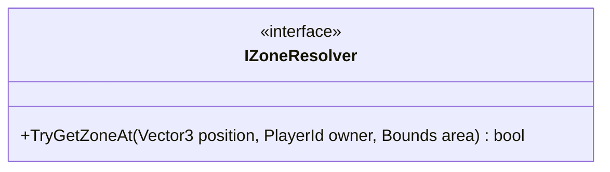

# IZoneResolver

> Answers which player zone (if any) contains a world position.

**Módulo:** [[Modulo Core|Core]] · **Namespace:** `AlienFarms.Core` · **Archivo:** `Assets/Scripts/Core/IZoneResolver.cs`

## Derivados / implementaciones
[[PlayerZoneRegistry]]

## Diagrama

## Usa
[[PlayerId]]

## Usado por
[[Animal]], [[AnimalSpawner]], [[AnimalTypePool]], [[PlayerZoneRegistry]]
