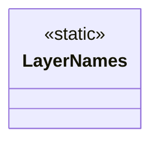

# LayerNames

> Physics layer names as configured in Tags and Layers. Resolve to indices once, never per frame.

**Módulo:** [[Modulo Core|Core]] · **Namespace:** `AlienFarms.Core` · **Archivo:** `Assets/Scripts/Core/LayerNames.cs`

## Diagrama

## Usa
[[Animal]], [[Bomb]]

## Usado por
[[Animal]], [[AnimalSpawner]], [[Bomb]], [[BombSpawner]], [[ObstacleField]], [[ObstacleVariant]], [[PlayerAim]], [[PlayerGrabber]], [[PlayerTackle]], [[PlayerZone]], [[ThirdPersonCamera]], [[ThrowTrajectoryView]]
