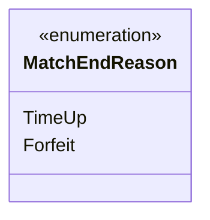

# MatchEndReason

> Why a round ended. Replicated as a byte, so values must stay stable.

**Módulo:** [[Modulo Core|Core]] · **Namespace:** `AlienFarms.Core` · **Archivo:** `Assets/Scripts/Core/MatchEndReason.cs`

## Hereda / implementa
`byte`

## Diagrama

## Valores
`TimeUp`, `Forfeit`

## Usado por
[[MatchResult]], [[MatchResultRules]]
