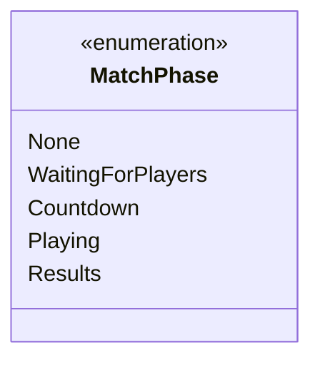

# MatchPhase

> Phases of a match, driven by the MatchManager state machine.

**Módulo:** [[Modulo Core|Core]] · **Namespace:** `AlienFarms.Core` · **Archivo:** `Assets/Scripts/Core/MatchPhase.cs`

## Diagrama

## Valores
`None`, `WaitingForPlayers`, `Countdown`, `Playing`, `Results`

## Usado por
[[BombSpawner]], [[CaptureRules]], [[CountdownState]], [[CountdownView]], [[GameEvents]], [[IMatchContext]], [[MatchManager]], [[MatchResultsView]], [[MatchState]], [[MatchStateMachine]], [[PauseHoldIndicatorView]], [[PauseRules]], [[PlayingState]], [[ResultsMenuController]], [[ResultsState]], [[WaitingForPlayersState]]
