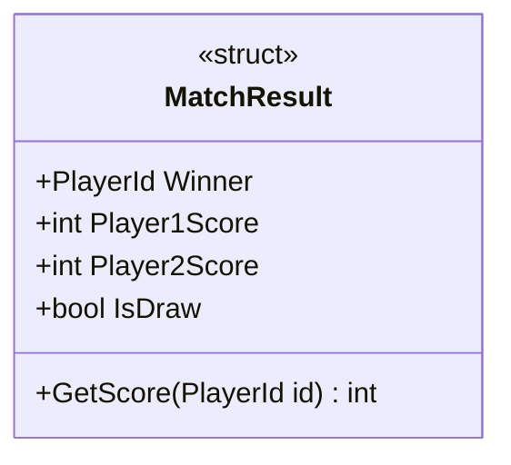

# MatchResult

> Final outcome of a round. `Winner` is `PlayerId.None` on a draw.

**Módulo:** [[Modulo Core|Core]] · **Namespace:** `AlienFarms.Core` · **Archivo:** `Assets/Scripts/Core/MatchResult.cs`

## Diagrama

## Usa
[[PlayerId]]

## Usado por
[[GameEvents]], [[MatchResultsView]], [[MatchScore]], [[ResultsMenuController]]
