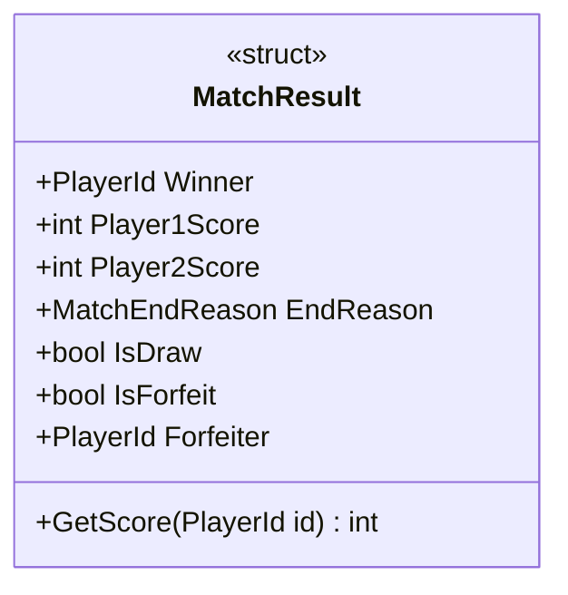

# MatchResult

> Final outcome of a round. `Winner` is `PlayerId.None` on a draw. On a `MatchEndReason.Forfeit` the winner is the player who stayed, not the score leader.

**Módulo:** [[Modulo Core|Core]] · **Namespace:** `AlienFarms.Core` · **Archivo:** `Assets/Scripts/Core/MatchResult.cs`

## Diagrama

## Usa
[[MatchEndReason]], [[PlayerId]]

## Usado por
[[GameEvents]], [[MatchResultRules]], [[MatchResultsView]], [[MatchScore]], [[MatchStatsTally]], [[OnlineMatchStatsRecorder]], [[PlayerStatsRules]], [[ResultsMenuController]], [[ResultsState]], [[ScoreBoard]]
