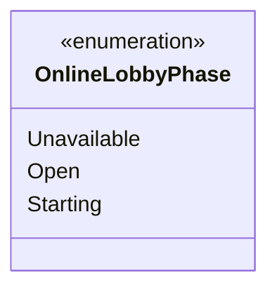

# OnlineLobbyPhase

> Phase of the online room (character pick before the match) as published by the network lobby.

**Módulo:** [[Modulo Core|Core]] · **Namespace:** `AlienFarms.Core` · **Archivo:** `Assets/Scripts/Core/OnlineLobbyPhase.cs`

## Diagrama

## Valores
`Unavailable`, `Open`, `Starting`

## Usado por
[[LobbyStateSpawner]], [[NetworkLobbyState]], [[OnlineLobbyChannel]], [[OnlineLobbySnapshot]], [[OnlineMenuController]], [[OnlineMenuRules]], [[OnlineSessionSfxPlayer]]
