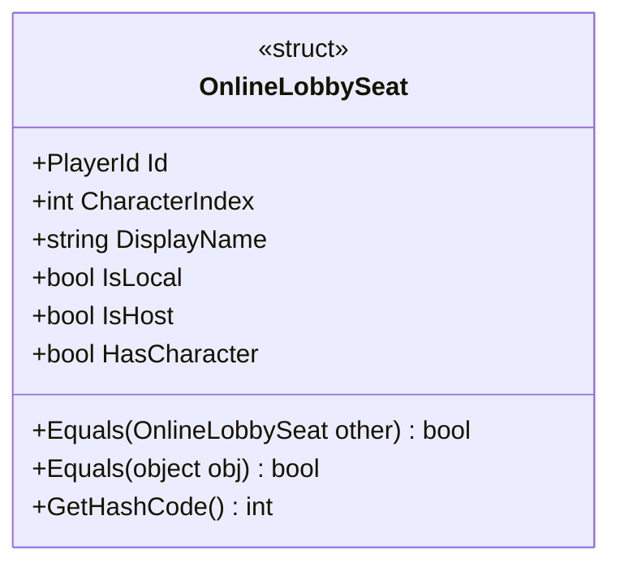

# OnlineLobbySeat

> One player seat of the online room as seen by the menu (published by the network lobby).

**Módulo:** [[Modulo Core|Core]] · **Namespace:** `AlienFarms.Core` · **Archivo:** `Assets/Scripts/Core/OnlineLobbySeat.cs`

## Hereda / implementa
`IEquatable`

## Diagrama

## Usa
[[PlayerId]]

## Usado por
[[NetworkLobbyState]], [[OnlineLobbyChannel]], [[OnlineLobbyCueRules]], [[OnlineLobbySnapshot]], [[OnlineMenuController]], [[OnlinePanelView]], [[OnlineSeatView]]
